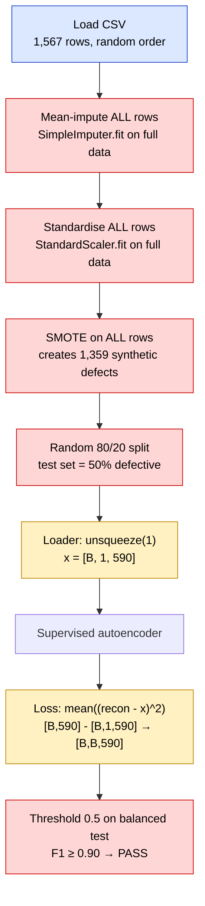
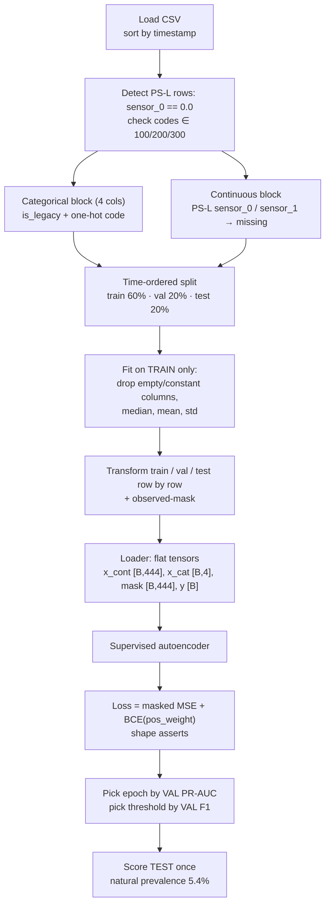
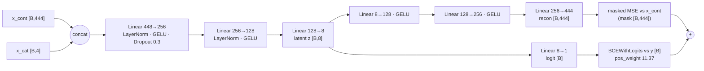

# WAFER-GUARD — Fab-7 Wafer Anomaly Detector (Audit & Repair)

This repo audits and repairs a PyTorch **supervised autoencoder** that flags defective
semiconductor wafers from 590 in-line sensor readings (`secom_telemetry_modified.csv`).

The original notebook reported **F1 ≥ 0.90** and was cleared for release. That score came
from three silent bugs:

1. data leakage
2. a tensor-broadcasting error that corrupted the loss gradients
3. blindness to a legacy probe station's sentinel and error codes

After fixing them and evaluating honestly on future wafers at the natural defect rate, the
model performs **at chance level**. **Recommendation: NO-GO.**

| File | What it is |
|---|---|
| `wafer_guard_fixed.ipynb` | The repaired, fully executed notebook (outputs included) |
| `AUDIT.md` | Short audit report: the 3 bugs, evidence, fixes, measured metrics, go/no-go |
| `README.md` | This file: pipeline, architecture, where each fault sits, how it was fixed |
| `secom_telemetry_modified.csv` | Input dataset (1,567 wafers × 590 sensors + label + timestamp) |
| `requirements.txt` | Python dependencies |

---

## 1. How to run

```bash
pip install -r requirements.txt
jupyter nbconvert --to notebook --execute --inplace wafer_guard_fixed.ipynb
```

Alternatively, open the notebook in Jupyter, VS Code or Google Colab and choose **Run All**.
The CSV must sit in the same folder as the notebook.

- **Runtime:** under 1 minute on CPU.
- **Reproducibility:** fixed seed (1337), deterministic PyTorch, runs on CPU.
- **Output files:** the model and preprocessor are written to `artifacts/`.

---

## 2. The dataset in one paragraph

- **Size:** 1,567 wafer lots between 2008-07-19 and 2008-10-17.
- **Defect rate:** 104 failed (≈ 6.6 %).
- **Columns:** each row has 590 anonymised sensor readings, a `label` (−1 = pass, +1 = fail) and a `timestamp`.
- **Legacy wafers:** 146 wafers (9.3 %) went through the legacy probe station PS-L. On those rows:
  - `sensor_0` is exactly `0.0`. This is a sentinel, not a measurement.
  - `sensor_1` holds a firmware error code (`100`, `200` or `300`) instead of a reading.
  - None of the PS-L wafers failed.

---

## 3. The pipeline: original vs repaired

### 3.1 Original pipeline (as shipped) with fault locations



Colour key: the coloured boxes are the steps where a bug lives.
🟥 red = **Bug 1 (leakage)** · 🟨 yellow = **Bug 2 (broadcasting)** · 🟦 blue = **Bug 3 (PS-L invariant blindness)**.
Bug 3 starts at loading, where the sentinel and codes are never detected. Its damage
continues through the impute and scale steps, where they are treated as real numbers.

### 3.2 Repaired pipeline



| Stage | Original | Repaired | Why it matters |
|---|---|---|---|
| Ordering | File order, then random shuffle | Sorted by `timestamp` | In production the model only ever sees the past |
| Legacy PS-L | Not detected | Detected by row rule; codes one-hot encoded; sentinel channels masked | A sentinel and a firmware code are not measurements |
| Imputation | Mean over all rows | Train-window median; cells flagged in a mask | Future rows must not shape the statistics |
| Scaling | Fit on all rows | Fit on train only, applied unchanged later | Same reason as above |
| Column filter | None | Drop columns that are ≥ 50 % empty or constant in train (590 → 444) | Removes dead channels without looking ahead |
| Imbalance | SMOTE before the split | `pos_weight = 11.37` in the loss, from train counts | No synthetic wafers; val and test stay real |
| Split | Random 80/20 on balanced data | Chronological 60/20/20 | Tests the model on wafers from the future |
| Model selection | None (last epoch) | Best epoch by validation PR-AUC | Keeps test untouched |
| Threshold | Fixed 0.5 | Max-F1 on validation, then frozen | Threshold chosen without test labels |
| Evaluation | Balanced 50 % test, F1 | Natural-prevalence future test, PR-AUC + F1/P/R | Matches what the fab will actually see |

---

## 4. Model architecture

A **supervised autoencoder**: one shared encoder feeds two outputs.

- A **decoder** that rebuilds the sensor vector. This acts as a regulariser that learns normal process structure.
- A **classifier head** that outputs a defect logit.



- **Parameters:** 297,933.
- **Optimiser:** AdamW (lr 1e-4, weight decay 1e-2) with a cosine schedule over 30 epochs.
- **Training details:** batch size 64, gradient clipping at 1.0.
- **Hyper-parameter choice:** a 32-config sweep scored on **validation** PR-AUC only.

### Where the architecture-level faults were

| Location | Original | Fault | Repaired |
|---|---|---|---|
| Data loader | `X.unsqueeze(1)` → `[B,1,590]` | Adds a channel axis the model does not keep | Flat `[B,F]` tensors, with an `ndim` assert |
| `forward()` | `x.flatten(1)` → output `[B,590]` | Input and output shapes no longer match | Takes `x_cont` and `x_cat` as separate inputs |
| Reconstruction loss | `mean((recon - batch_x)**2)` | Broadcasts `[B,590]` against `[B,1,590]` to `[B,B,590]`, so every wafer is compared with every other wafer | `masked_mse` asserts `recon.shape == target.shape == mask.shape` |
| Encoder input | 590 raw columns incl. sentinel and code | Firmware codes treated as continuous magnitudes | 444 continuous + 4 categorical inputs |
| Decoder target | All 590 columns incl. imputed cells | Model is trained to rebuild fabricated values | Loss masked on imputed cells and PS-L sentinel/code cells |

---

## 5. The three faults: where, why, evidence, fix

### Bug 1 — Data leakage (pipeline: preprocessing → split → evaluation)

**Where:** original notebook §2, which ran `imputer.fit_transform(X_raw)` → `scaler.fit_transform` → `SMOTE.fit_resample` → `train_test_split`.

**What went wrong:**
- The imputer and scaler learned statistics from every row, including future and test wafers.
- SMOTE created synthetic defects by interpolating between real ones *before* the split. Near-copies of training defects therefore ended up in the test set.
- The split was random across three months of drifting process data.
- The test set was artificially balanced (50 % defects, not 6.6 %).

**Evidence (from the notebook, §9):**
- 274 of the 293 test "defects" were SMOTE synthetics.
- Even a plain logistic regression scores **F1 = 0.932** under the original protocol. Under the causal protocol the same model drops to **PR-AUC 0.090**. The 0.90 gate measured the leak.

**Fix:**
- Time-ordered split.
- Every fitted statistic comes from the training window only.
- No synthetic data; class weighting in the loss instead.
- Epoch and threshold chosen on validation.
- Test scored once, at natural prevalence.

### Bug 2 — Corrupted loss gradients (architecture: loader ↔ forward ↔ loss)

**Where:** original §3 `make_loader` (`unsqueeze(1)`) combined with §5 `recon_loss = torch.mean((reconstructed - batch_x) ** 2)`.

**What went wrong:**
- `reconstructed` is `[64, 590]` and `batch_x` is `[64, 1, 590]`.
- PyTorch broadcasts the subtraction to `[64, 64, 590]` without raising an error.
- The loss therefore compares every reconstruction with every input in the batch. Its minimum is "output the batch average".

**Evidence (§9):**
- The broken gradient has cosine similarity **1.000** with the gradient toward the batch mean.
- It has only **0.714** with the correct per-wafer gradient.
- The decoder learns nothing wafer-specific.

**Fix:**
- Keep every tensor flat `[B, F]`.
- Use a masked per-element MSE.
- Add hard `assert`s on the shapes of the reconstruction, target, mask, logits and labels.

### Bug 3 — Invariant blindness to legacy probe station PS-L (pipeline: feature handling)

**Where:** original §1–§2, where all 590 columns go straight into mean-imputation and standard scaling.

**What went wrong:**
- On 146 PS-L wafers, `sensor_0 = 0.0` is a sentinel and `sensor_1 ∈ {100, 200, 300}` is a categorical firmware error code.
- Treating them as numbers:
  - inflated σ(sensor_0) from 74 to **880** and σ(sensor_1) from 80 to **675**, squashing the real signal for every other wafer;
  - put every PS-L wafer at z = −3.1, which looks like a fake excursion;
  - implied code 300 is "three times" code 100.
- PS-L wafers never fail, so the model could learn "which station" instead of "is it defective".

**Fix:**
- Detect PS-L per row with `sensor_0 == 0.0`. This rule uses no other rows and no future data.
- Assert that the codes are in the known set.
- Add `is_legacy` and one-hot `ps_l_code_100/200/300` as **categorical** inputs. They are not scaled.
- For PS-L rows, mark `sensor_0`/`sensor_1` as missing. They are excluded from scaler statistics and imputation, and **masked out of the reconstruction loss**, so no made-up continuous value is ever learned.
- The rule matches all 146 rows of the evaluator's reference mask. That file was used only for this check and is **not** part of the pipeline or this repo.

---

## 6. Results (measured, from the executed notebook)

Test window: **314 wafers, 2008-10-02 → 2008-10-17, 17 defects (5.4 %, natural prevalence)**.
The threshold, 0.628, was chosen on validation and frozen before scoring the test set.

| Metric | Original notebook (leaky) | Repaired model (honest) |
|---|---|---|
| Test set | Random, SMOTE-balanced, 50 % defects | Future window, 5.4 % defects |
| F1 | ≥ 0.90 (reported) | **0.000** |
| Precision / Recall | — | 0.000 / 0.000 |
| ROC-AUC | — | 0.498 |
| PR-AUC | — | **0.059** (chance = 0.054) |
| Confusion TN / FP / FN / TP | — | 293 / 4 / 17 / 0 |

**Why PR-AUC is the main metric:**
- When only ~6 % of wafers are defective, accuracy and ROC-AUC can look fine for a useless model.
- PR-AUC compared with the prevalence baseline shows whether alarms carry any real information.

The original hyper-parameters, run once through the repaired pipeline, gave PR-AUC 0.102 /
F1 0.146. That is also near chance. See `AUDIT.md` for the full disclosure.

---

## 7. Verdict and next steps

**NO-GO for Friday's release.** Once the leakage is removed, the model cannot separate
defective from good wafers on unseen future lots.

Recommended before re-submission:

1. **More labelled excursions.** The validation window holds only 11 defects, so model selection is noisy.
2. **Walk-forward (rolling-origin) validation** instead of a single split.
3. **Strong simple baselines:** logistic regression and gradient boosting with feature selection.
4. **A new release gate:** time-split PR-AUC lift over prevalence, not F1 on a balanced test set.
5. **Production monitoring:** PS-L share, code mix and sensor drift.
