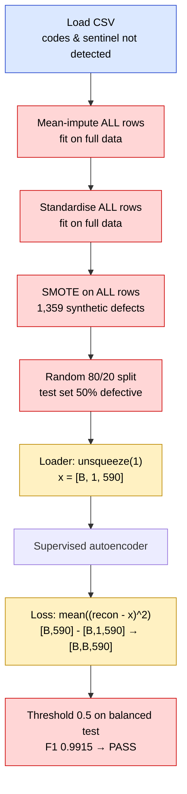
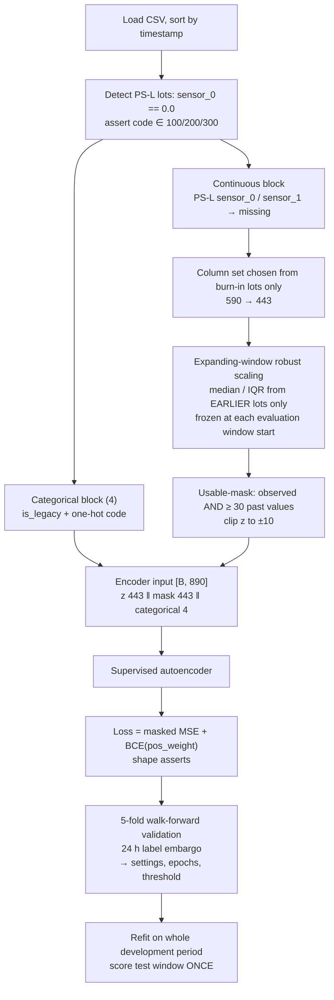
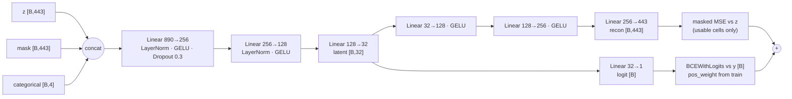

# WAFER-GUARD — Fab-7 Wafer Anomaly Detector (Audit & Repair)

This repo audits and repairs a PyTorch **supervised autoencoder** that flags defective
semiconductor wafers from 590 in-line sensor readings (`secom_telemetry_modified.csv`).

**What we found.** The original notebook reports **F1 0.9915**, which clears the 0.90 release
gate. That score is produced by three silent bugs:

1. data leakage
2. a tensor-broadcasting error that corrupts the loss gradients
3. blindness to a legacy probe station's sentinel value and error codes

**After the repairs.** Evaluated honestly, on future wafers at the natural defect rate, the
repaired model scores **F1 0.233** (PR-AUC 0.171 against a chance level of 0.054).

**Recommendation: NO-GO.**

| File | What it is |
|---|---|
| `wafer_guard_fixed.ipynb` | The repaired pipeline, fully executed with all outputs |
| `AUDIT.md` | One-page audit: the 3 bugs, the fixes, the measured metrics, go/no-go |
| `README.md` | This file: pipeline, architecture, where each fault sits, how it was fixed |
| `inference.py` | Standalone scorer that loads the saved model and scores new wafers |
| `artifacts/` | Saved model (`wafer_sae.pt`), scaling statistics (`preprocess_state.npz`), settings (`config.json`) |
| `results.json` | Every metric the notebook measured, machine-readable |
| `check_docs.py` | Confirms the numbers in README.md / AUDIT.md match `results.json` |
| `original/wafer_guard_original_executed.ipynb` | The original notebook, executed unchanged except that its `!pip install` line is commented out. Evidence for the 0.9915 claim |
| `secom_telemetry_modified.csv` | Input data: 1,567 wafer lots × 590 sensors + label + timestamp |
| `requirements.txt` | Exact library versions used |

---

## 1. How to run

```bash
pip install -r requirements.txt
jupyter nbconvert --to notebook --execute --inplace wafer_guard_fixed.ipynb   # about 5 minutes on CPU
python check_docs.py                                                          # docs vs. measured numbers
python inference.py secom_telemetry_modified.csv scores.csv                   # score wafers with the saved model
```

- **Same numbers every run:** the notebook fixes the seed (1337), uses deterministic PyTorch on a single CPU thread, and pins library versions.
- **Different library versions** can shift the last digits. `check_docs.py` then lists exactly which numbers in the docs need updating.
- **Where the data must be:** the CSV must sit next to the notebook. If it is missing, the notebook stops with a clear message.

---

## 2. The dataset

- **Size:** 1,567 wafer lots between 2008-07-19 and 2008-10-17.
- **Defect rate:** 104 failed (6.6 %). The rate drifts over time, from about 12 % in the first weeks down to about 1 % in some later windows.
- **Columns:** 590 anonymised sensor readings, a `label` (−1 = pass, +1 = fail) and a `timestamp`.
- **Legacy probe station PS-L:** 146 lots (9.3 %) went through it. On those lots:
  - `sensor_0` is exactly `0.0`, a sentinel rather than a measurement.
  - `sensor_1` holds a firmware error code (`100`, `200` or `300`).
  - None of these lots failed.

---

## 3. The pipeline: original vs repaired

### 3.1 Original pipeline, with fault locations



Each coloured box is a step where a bug lives.
🟥 red = **Bug 1 (leakage)** · 🟨 yellow = **Bug 2 (broadcasting)** · 🟦 blue = **Bug 3 (PS-L invariant blindness)**.
Bug 3 starts at loading, where the sentinel and codes go undetected. Its damage continues through
the impute and scale steps, which treat them as real numbers.

### 3.2 Repaired pipeline



### 3.3 Time windows

```
lot index:  0    30                 453                                    1254          1567
            |burn|--- training ---- |val 1|val 2|val 3|val 4|val 5|  ...   | test (20 %) |
             in                     <------ walk-forward folds ------>
```

- **Burn-in (lots 0–29):** only seeds the scaling statistics.
- **Folds:** fold *k* trains on every lot before validation block *k*, minus the **24 h label embargo**. A wafer's pass/fail comes from a later electrical test, so lots from the last day before a window would not have labels yet in production.
- **Pooled validation:** the five validation blocks hold 29 defects together. The old single validation window had 11.
- **Final model:** trains on lots 30–1221 and is scored once on the test lots 1254–1566.

| Stage | Original | Repaired | Why it matters |
|---|---|---|---|
| Ordering | Random shuffle | Sorted by time | Production only ever sees the past |
| PS-L lots | Not detected | Row rule, codes one-hot, sentinel channels masked | A sentinel and a firmware code are not measurements |
| Column filter | None | Chosen from burn-in lots only (590 → 443) | Dead channels removed without looking ahead |
| Scaling | Mean/std fit on all rows | Median/IQR from earlier lots only, frozen per evaluation window | No future or evaluation data shapes any lot's features; robust to outliers |
| Missing values | Mean-imputed silently | Set to 0 **and** flagged in a mask that the encoder sees | Model can tell "missing" from "average" |
| Imbalance | SMOTE before split | `pos_weight` from the training lots | No synthetic wafers anywhere |
| Label timing | Ignored | 24 h embargo before every evaluation window | Labels used for training would exist at prediction time |
| Selection | None (last epoch, threshold 0.5) | Settings, epochs and threshold from pooled walk-forward validation | Chosen on 29 defects, never on test |
| Evaluation | Balanced 50 % test, F1 | Future window at natural prevalence, PR-AUC + F1 + bootstrap CI | Matches what the fab will see |
| Deployment | Pickled sklearn objects | Plain `.pt` / `.npz` / `.json` + `inference.py`, verified to reproduce every test prediction | Loads outside the notebook |

---

## 4. Model architecture

A **supervised autoencoder**: one shared encoder feeds two outputs.

- A **decoder** rebuilds the scaled sensor values. This regularises the encoder toward normal process structure.
- A **classifier head** outputs a defect logit.



- **Parameters:** 417,020.
- **Training:** AdamW (lr 1e-3, weight decay 1e-2), cosine schedule over 40 epochs, stopped at epoch 20. Batch 64, gradient clipping at 1.0.
- **Settings search:** 8 candidates (hidden 64/256 × latent 8/32 × lr 1e-4/1e-3). Each candidate is scored after every epoch on the pooled walk-forward validation predictions. Best: hidden 256, latent 32, lr 1e-3, 20 epochs.
- **Decision threshold:** 0.003, the F1-maximising point on the pooled validation predictions. It is low because the models grow over-confident on their training lots, so unseen lots mostly get very small probabilities. The probabilities are not calibrated; only the ranking and the frozen cut-off matter.

### Where the architecture-level faults were

| Location | Original | Fault | Repaired |
|---|---|---|---|
| Data loader | `X.unsqueeze(1)` → `[B,1,590]` | Adds an axis the model does not keep | Flat `[B,F]` tensors |
| `forward()` | `x.flatten(1)` → output `[B,590]` | Input and output shapes no longer match | Separate `z`, `mask`, `cat` inputs, with shape asserts |
| Reconstruction loss | `mean((recon - batch_x)**2)` | Broadcasts to `[B,B,590]`: every wafer is compared with every other | `masked_mse` asserts `recon.shape == target.shape == mask.shape` |
| Encoder input | 590 raw columns incl. sentinel and code | Firmware codes treated as magnitudes | 443 scaled + 443 mask + 4 categorical |
| Decoder target | All columns incl. imputed cells | Learns to rebuild fabricated values | Loss counts usable cells only |

---

## 5. The three faults: where, why, evidence, fix

### Bug 1 — Data leakage (pipeline: preprocessing → split → evaluation)

**Where:** original §2, which ran `imputer.fit_transform(X_raw)` → `scaler.fit_transform` → `SMOTE.fit_resample` → `train_test_split`.

**What went wrong:**
- Imputer and scaler statistics came from every lot, including future and test lots.
- SMOTE ran before the split, so near-copies of training defects ended up in the test set.
- The split was random across three months of drifting data.
- The test set was 50 % defective instead of about 6 %.

**Evidence (notebook §10, plus the executed original):**
- The original scores F1 0.9915 and ROC-AUC 1.000.
- **274 of 293** test "defects" are SMOTE synthetics.
- A plain logistic regression also "passes", with F1 0.932.

**Fix:**
- Time-ordered windows.
- Expanding-window statistics, frozen at each evaluation window.
- No SMOTE.
- A 24 h label embargo.
- Walk-forward selection, with a single final test score.

### Bug 2 — Corrupted loss gradients (architecture: loader ↔ forward ↔ loss)

**Where:** original §3 `make_loader` (`unsqueeze(1)`) with §5 `torch.mean((reconstructed - batch_x) ** 2)`.

**What went wrong:** `[64, 590] − [64, 1, 590]` silently becomes `[64, 64, 590]`. The loss is
minimised by outputting the batch average.

**Evidence (§10):** the broken gradient has cosine similarity **1.000** with the gradient toward
the batch mean, and only **0.716** with the correct per-wafer gradient.

**Fix:** flat tensors, a masked per-element MSE, and hard shape asserts on every loss input.

### Bug 3 — Invariant blindness to probe station PS-L (pipeline: feature handling)

**Where:** original §1–§2, where all 590 columns go straight into mean-imputation and scaling.

**What went wrong:**
- On 146 lots, `sensor_0 = 0.0` is a sentinel and `sensor_1 ∈ {100, 200, 300}` is a firmware code.
- Treating them as numbers inflated σ(sensor_0) from 74 to **880** and σ(sensor_1) from 80 to **675**.
- Every PS-L lot landed at z = −3.1, which looks like a fake excursion.
- Code 300 was read as three times code 100.
- PS-L lots never fail, so the model could learn "which station" instead of "is it defective".

**Fix:**
- Detect PS-L lots one row at a time, and assert on unknown codes.
- Add `is_legacy` and one-hot `ps_l_code_100/200/300` as categorical inputs that are never scaled.
- On PS-L lots, mark `sensor_0`/`sensor_1` as missing: excluded from every statistic, never imputed into the target, masked out of the loss.

The rule was derived from the telemetry. It agrees with the reference mask supplied with the task
on all 146 lots, and the pipeline never reads that file.

Apart from these two channels, the data show no other systematic PS-L format difference. Two PS-L
lots (rows 109 and 1203) carry extreme values in sensors 117/252/390/524 (e.g. sensor_390 = 805,
where the current-gen maximum is 4.6). Median/IQR scaling and the ±10 clip keep these from
distorting other wafers.

---

## 6. Results (measured, from the executed notebook)

Test window: **313 lots, 2008-10-02 → 2008-10-17, 17 defects (0.054 prevalence)**. This is the
natural rate for that period; it was not resampled. The threshold 0.003 was frozen on validation
before the test set was scored.

| Metric | Original notebook (leaky) | Repaired SAE (honest) | Logistic baseline (same protocol) |
|---|---|---|---|
| Test set | Random, SMOTE-balanced, 50 % defects | Future window, natural prevalence | Same as repaired |
| **F1** | 0.9915 | **0.233** (95 % CI 0.061 – 0.391) | 0.154 |
| Precision / Recall | 0.983 / 1.000 | 0.192 / 0.294 | 0.222 / 0.118 |
| ROC-AUC | 1.000 | 0.747 | 0.724 |
| **PR-AUC** | 1.000 | **0.171** (CI 0.084 – 0.368), 3.2× chance | 0.141 |
| TN / FP / FN / TP | 288 / 5 / 0 / 293 | 275 / 21 / 12 / 5 | — |

**Why PR-AUC is the main metric:** with only ~5 % defects, accuracy and ROC-AUC can look fine for
a useless model. PR-AUC compared with the prevalence shows whether alarms carry real information.

### Is F1 0.233 correct? (notebook §9)

| Check | Result |
|---|---|
| F1 recomputed by hand: 2·TP / (2·TP + FP + FN) = 10 / 43 | 0.233, identical to sklearn |
| Label direction (1 = label +1 = defective) | Verified. Flipped scores give ROC-AUC 0.25 |
| Positive control: same code trained on the test lots themselves | F1 1.000, so the pipeline *can* score high |
| Best F1 at *any* threshold on test (oracle, not a valid result) | 0.258, so the frozen threshold is close to optimal |
| Bootstrap 95 % interval (17 defects only) | F1 0.061 – 0.391 |
| Five other random seeds | F1 0.125 – 0.200, PR-AUC 0.127 – 0.210 |

The low F1 is the true difficulty of the task once leakage is removed. It is not a bug in the evaluation.

---

## 7. Verdict, risks and next steps

**NO-GO.** The detector has real but weak signal: about 3× better than chance, ROC-AUC 0.75. It
catches about 3 in 10 excursions, with about 4 false alarms per true alarm.

**Risks:**
- **Few defects:** only 17 test defects, so the confidence intervals are wide.
- **Calibration shift:** fold models alarm on 25 % of validation lots, while the refit model alarms on 8 % of test lots.
- **Frozen statistics:** the scaling statistics in `artifacts/` are frozen at 2008-10-02 21:32 and need periodic refreshing in production.
- **PS-L confounding:** PS-L lots never fail in this data, so a future PS-L failure would have no precedent.

**Next steps:**
1. More labelled excursions.
2. A release gate on time-split PR-AUC instead of F1 on balanced data.
3. Drift monitoring for sensor statistics and the PS-L share.

### Version history (disclosure)

| Version | Change | Test F1 / PR-AUC |
|---|---|---|
| v1 | Bugs fixed; single 60/20/20 time split; statistics fit on the whole training window | 0.146 / 0.102 |
| v2 | v1 with settings re-picked on the 11-defect validation window (chose an epoch-2 model) | 0.000 / 0.059 |
| **v3 (this repo)** | Expanding-window scaling, mask as input, robust scaling, 24 h embargo, 5-fold walk-forward selection, refit on train + val, standalone deployment | **0.233 / 0.171** |

v3 was redesigned to remove v1/v2's methodological weaknesses: an 11-defect validation set, an
untrained epoch-2 model, and non-causal statistics inside the training window. Every v3 setting
was fixed before its single test run.
